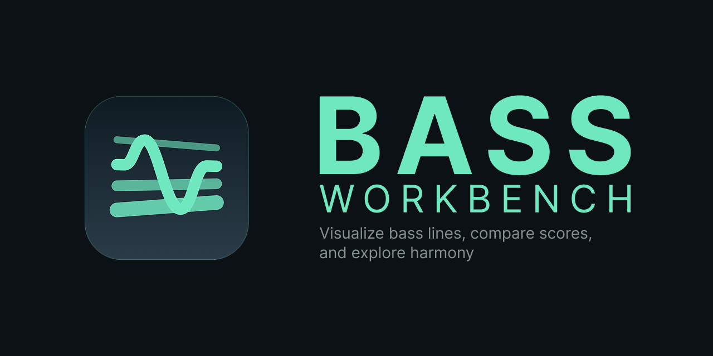

# Bass Harmony Workbench

給貝斯手使用的 macOS 本機採譜與練習工具。匯入音訊和參考譜後，可以反覆聽同一小節，對照音高分布與譜面，再記下自己確認的首音、根音與和弦。

- **聽與練**　查看波形、BPM 與拍點，用 A–B 循環和變速播放練習難句。
- **對照樂譜**　匯入參考譜，將譜面與音訊時間對齊，逐段核對。
- **分析和聲**　參考低音與和弦候選，分別編輯或鎖定首音、根音和和弦。原始音訊、樂譜與人工標註保存在本機專案中。

## 開始使用

適用於 Apple Silicon Mac，macOS 14 或以上。操作流程與從原始碼建置的方式見[使用與建置說明](source/README.md)。
