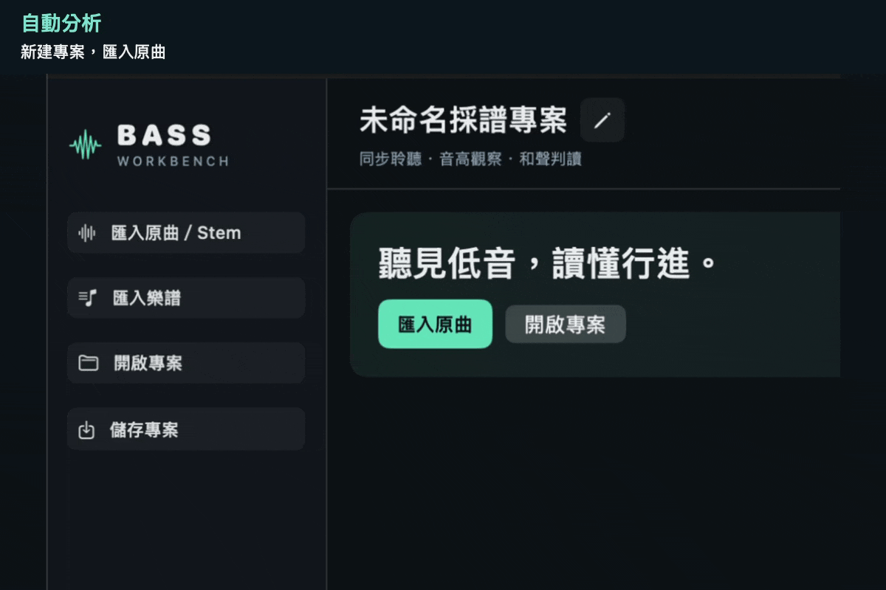
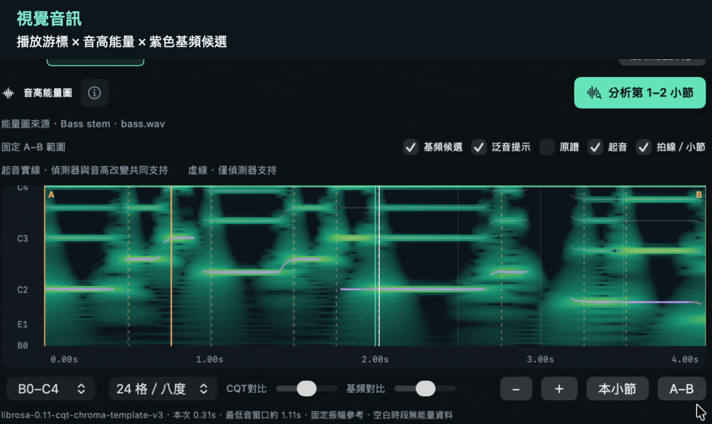
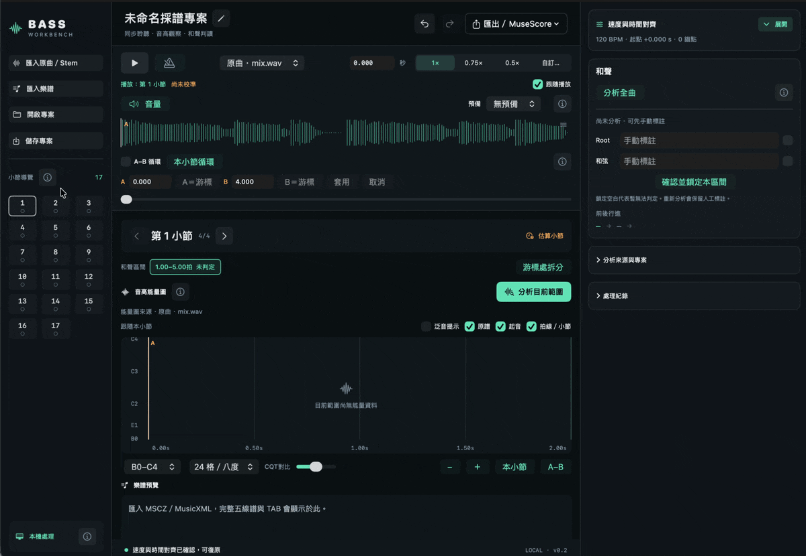
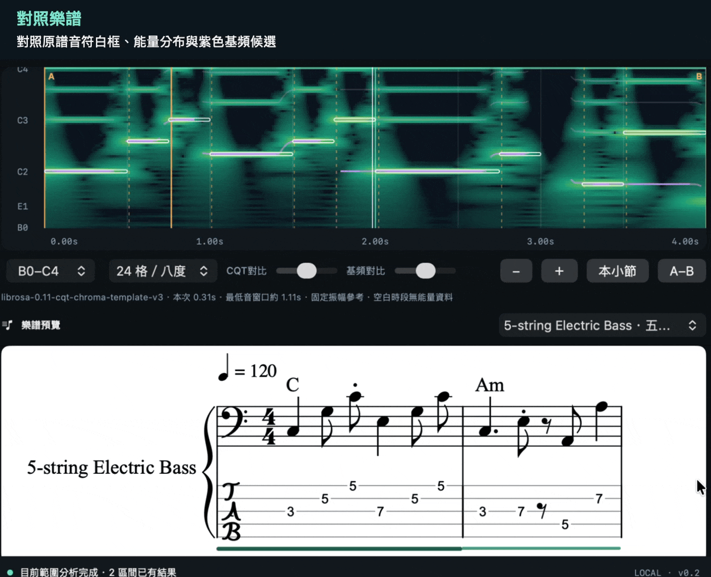
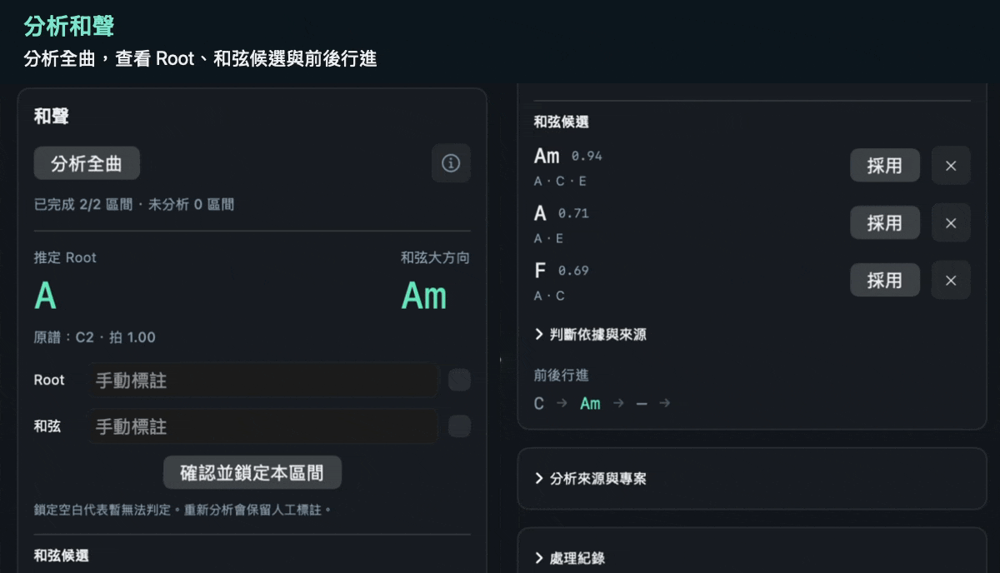

# Bass Harmony Workbench

給貝斯手使用的 macOS 本機採譜與練習工具。匯入音訊和參考譜後，可以反覆聽同一小節或段落，對照音高分布與譜面，再記下自己確認的首音、根音與和弦。
原始音訊、樂譜與人工標註均保存在本機專案中。

- **自動分析** 匯入後自動偵測 BPM、首拍位置與和聲候選。

  

- **視覺音訊** 以 CQT 顯示各頻率能量，結合 pYIN 預測基頻，輔助分辨泛音與實際音高。

  

- **聽與練**　快速設定 A–B 循環和變速播放，抓準並練習難句。

  

- **對照樂譜**　支援 `mscz` 與 `musicXML` 格式樂譜，與音訊對齊後逐段核對。

  

- **分析和聲**　參考低音與和弦候選，分別編輯或鎖定首音、根音和和弦。

  

## 建置

適用於 Apple Silicon Mac，macOS 14 或以上。操作流程與從原始碼建置的方式見[使用與建置說明](source/README.md)。

## 開始使用

[Quick Start](docs/quick-start.md)
